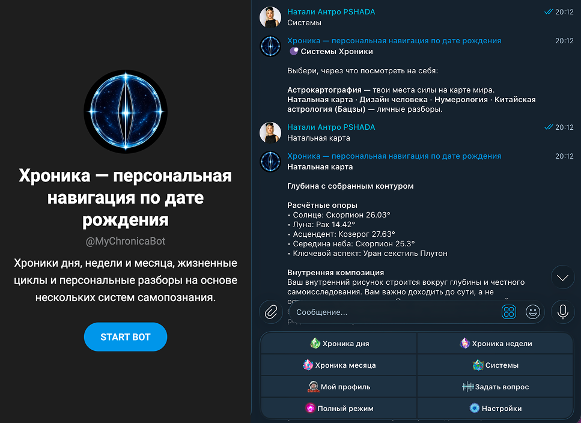
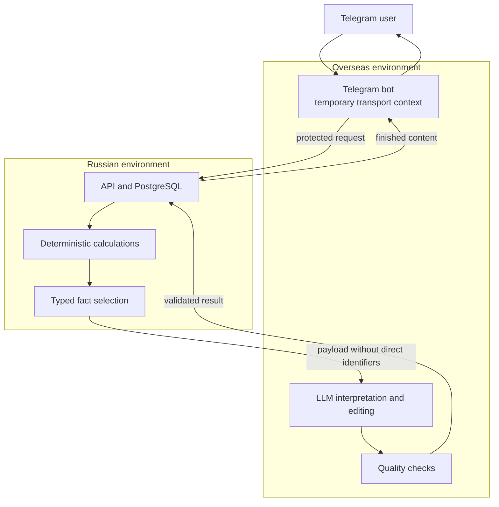
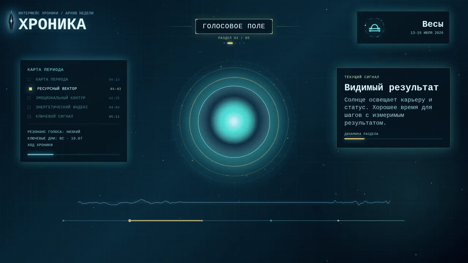
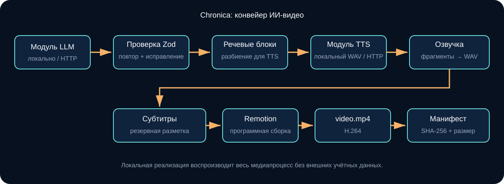
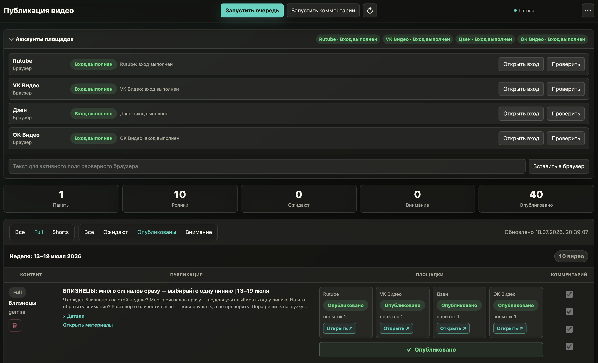

[🇬🇧 English](README.md) | [🇷🇺 Русский](README.ru.md)

# Chronica — Personal AI and Media Platform

Chronica is a personal AI platform on Telegram and an automated media production system. This repository contains a reproducible video pipeline that turns a typed script into an MP4 with narration and subtitles. Its artifact manifest records the status of each stage and the integrity of each output.

**Product:** [Chronica Telegram bot](https://t.me/MyChronicaBot) · [Chronica YouTube channel](https://youtube.com/@chronicaverse)

> **Public engineering showcase.** This repository contains a standalone media production pipeline and the LLM trust boundary of the commercial Chronica platform. The private production system also includes the personal Telegram service, calculation engines, subscriptions and payments, protected data storage, scheduling, and production integrations for publishing and operations.

<p align="center">
  <a href="docs/assets/telegram-product.png">
    
  </a>
</p>
<p align="center"><sub>Public product listing and a live Telegram conversation. Click the image to enlarge it.</sub></p>

## Product

Chronica brings together two independent but related product areas:

- **A personal Telegram service** with onboarding, explicit consent to data processing, a user profile, daily, weekly, and monthly Chronicles, structured analyses, personal questions, subscriptions, and payments.
- **A public media pipeline** for regularly producing long-form videos and Shorts. It covers scripting, TTS, transcription, subtitles, music, programmatic assembly in Remotion, thumbnails, metadata, and YouTube publishing.

The videos draw on the general context of each period and use no user profiles or personalized results. The media pipeline runs independently of the personal service and introduces new audiences to Chronica.

In production, the media pipeline supports the main YouTube channel's schedule of 12 long-form videos and 14 Shorts per week. It publishes finished videos through the official YouTube API.

## Role and scope

My work on Chronica covered the full product, from user flows and data architecture through content generation, media production, quality checks, and operations.

Key decisions:

- Run the personal service and public media production independently.
- Split processing between a Russian environment for persistent storage of personal data and deterministic calculations and an external layer for Telegram and AI integrations.
- Send the LLM only the data it needs, excluding direct Telegram identifiers, questionnaire fields, and raw calculation results.
- Ground generation in typed facts and use a first draft, an editing stage, repair, and quality checks.
- Make the multi-stage pipeline resumable with checkpoints in an artifact manifest.
- Build Chronica Public Publisher, a Playwright-based distribution module that imports a media package from S3, queues jobs, tracks explicit states, and hands off to an operator when login, a CAPTCHA, or manual review is required.
- Connect content production, distribution, and monetization within the Telegram product.

## Data and generation environments

Chronica uses separate Russian and overseas environments primarily to account for the requirements of [Federal Law No. 152-FZ on Personal Data](https://www.consultant.ru/document/cons_doc_LAW_61801/). The primary database for Russian citizens' personal data is hosted in the Russian environment in accordance with Article 18(5).

The Russian environment processes and stores user questionnaires, dates and places of birth, contact details, consent records, calculation history, subscription states, and payment-related information. It also runs deterministic calculations, normalizes data, and selects facts according to rules.



The overseas environment supports the Telegram bot and external services. Its temporary transport context lasts only for the duration of a request. Each integration receives only the information it needs. The external model receives typed facts selected for the specific request and a single-use `generationId`, with direct Telegram identifiers, questionnaire fields, and raw calculation results excluded. The LLM interprets the calculated data. The calculations run in the Russian environment.

The boundary between environments defines control points for access restrictions, protected data exchange, and validation of outbound payloads. Short retention periods for temporary data and minimal external context reduce the access surface and the volume of cross-border transfer required for operation. This design provides a technical foundation for the organizational and security measures described in Articles 18.1 and 19, including protection against unauthorized access, alteration, copying, and disclosure. It also isolates the primary personal data store from Telegram and LLM integrations.

The generation workflow follows a controlled sequence: **calculation → validated facts → first draft → editing → checks → finished content**.

## Media production

<p align="center">
  <a href="docs/assets/generated-video.gif">
    
  </a>
</p>
<p align="center"><sub>Excerpt from a published YouTube episode showing programmatic composition, synchronized graphics, and subtitles. Click to open the full-size GIF.</sub></p>

Media pipeline architecture:



Full production workflow:

```text
period context
    → script generation
    → schema validation and repair
    → narration blocks
    → TTS chunking and audio assembly
    → speech recognition and subtitle timing
    → music and composition
    → programmatic video assembly in Remotion
    → thumbnail and metadata
    → artifact manifest
    → publishing through the official YouTube API
    → upload of the finished media package to S3
    → import into Chronica Public Publisher
    → automated publishing on Rutube, VK Video, OK Video, and Dzen
```

The main engineering challenge in AI video production is keeping dependent transformations consistent. Invalid script structure affects composition, TTS limits require safe text chunking, and timing must reflect the actual duration of the finished audio.

### Additional distribution

YouTube is the primary publication channel and uses the official API. After publication, the finished media package, including the video, thumbnail, and metadata, is uploaded to S3.

Chronica Public Publisher uses Playwright to import the media package from object storage and distribute it independently to Russian video platforms. It manages the queue and authentication states and hands off to an operator when login, a CAPTCHA, or manual review is required.

<p align="center">
  <a href="docs/assets/publisher-dashboard.png">
    
  </a>
</p>
<p align="center"><sub>Additional distribution workflow showing sign-in status, the queue, and publishing results across four Russian platforms.</sub></p>

## What this repository demonstrates

Run the video production pipeline end to end, from a typed script to an MP4:

- A strict schema for LLM output.
- A dedicated repair stage when schema validation fails.
- Narration text chunking that respects provider limits and preserves order.
- WAV assembly and timing based on actual audio duration.
- Heuristic fallback for subtitle generation.
- Programmatic video composition in Remotion.
- Stage tracking with explicit statuses and atomic manifest updates.
- Per-stage attempt counts that distinguish reused outputs from stages that ran again.
- An explicit stage dependency graph and a recorded reason for each `reused` or `executed` decision.
- SHA-256 hashes and sizes for each artifact. Reuse requires an integrity check.
- Resumption from the stage where the previous run stopped, with verified outputs reused to avoid repeated LLM and TTS calls.
- Interfaces for external services and reproducible local implementations.
- Tests for the LLM trust boundary, failure recovery, text chunking, and timing.

## Design decisions

### Validate LLM output at the trust boundary

LLM responses cross an explicit trust boundary. The Responses API adapter requests Structured Outputs with a strict JSON Schema, then Zod validates the response again before it enters the domain model. The `generate` and `repair` prompts are versioned in code, and the provider receives the version for diagnostics.

`generateScenarioWithTrace` runs a bounded `generate → validate/evaluate → repair` loop. Each attempt records the action, decision, and errors. The pipeline writes the trace to `scenario-trace.json`, includes it in the manifest, and checks its SHA-256 hash alongside the script. If the attempt budget is exhausted, the pipeline fails explicitly.

### Evaluate output quality independently of schema validation

`evaluateScript` evaluates output quality separately from schema validity. A deterministic quality gate measures heading and section ID uniqueness, lexical diversity, coverage of the topic and required concepts, repeated sentences, prohibited patterns, and unsupported numerical claims.

The evaluation suite contains seven topical cases, including privacy, RAG, model drift, and prompt injection. Each case runs three times by default. The report records the distribution of results, `stabilityRate`, `firstPassRate`, p95 latency, and repair history. A case passes when the share of successful runs meets its threshold, so a single successful response cannot establish consistent quality. The deterministic local baseline runs offline. The same contract also runs against an external model, with `EVAL_RUNS` controlling the number of repetitions:

```bash
EVAL_PROVIDER=external EVAL_RUNS=3 npm run eval
```

### Split narration text before calling TTS

The pipeline splits narration text at sentence boundaries where possible and respects provider limits. It splits even a single URL or token that exceeds the limit into valid chunks. A worker pool limits concurrent TTS calls and preserves the original order of audio blocks regardless of response order.

### Derive timing from the generated audio

The pipeline parses every TTS response as RIFF/WAVE and validates the `fmt` and `data` chunks, PCM format, mono channel, 16 kHz sample rate, 16-bit depth, byte rate, and data bounds. It calculates duration from the generated PCM payload. Composition and subtitle timing use those measured durations, and Remotion assembles the frames deterministically.

### Use the manifest for recovery

After each stage, the pipeline atomically saves its status, attempt count, and artifact metadata. On restart, `runPipeline` checks the path, size, and SHA-256 hash. It rebuilds corrupt files and dependent artifacts and reuses validated outputs. Attempt counts make this behavior observable and testable.

Dependencies are explicit. Each stage stores a SHA-256 fingerprint of its semantic inputs, including the topic, prompt and evaluation contract versions, LLM and TTS profiles, chunking limit, and composition version. Changing the topic, model, or prompt invalidates the script and its downstream artifacts even when `RUN_ID` stays the same. Changing the TTS profile reuses the script and rebuilds the audio, subtitles, and video. Corrupt audio is rebuilt without calling the LLM again. The manifest records each stage's fingerprint and the reason it ran or was reused. The pipeline validates a user-supplied `RUN_ID` before creating a directory. The allowed format rules out absolute paths and traversal outside `artifacts/`.

### Keep external services behind provider interfaces

Provider interfaces isolate the LLM and TTS integrations. HTTP requests have explicit timeouts, and the pipeline validates TTS metadata before using it. Orchestration, validation, recovery, and video assembly can be reproduced locally without production credentials.

## Where to start reading the code

1. [runPipeline.ts](src/pipeline/runPipeline.ts) — stage orchestration, checkpoints, and recovery.
2. [validation.ts](src/domain/validation.ts) — the trust boundary for LLM output.
3. [llm.ts](src/providers/llm.ts) and [prompts/scenario.ts](src/prompts/scenario.ts) — Responses API, strict schema, and versioned prompts.
4. [services/scenario.ts](src/services/scenario.ts) and [scriptEvaluation.ts](src/evaluation/scriptEvaluation.ts) — bounded repair loop, execution trace, and quality checks.
5. [speech.ts](src/services/speech.ts) — TTS chunking and audio assembly.
6. [narration.ts](src/services/narration.ts) — narration blocks and timing.
7. [render.ts](src/services/render.ts) — programmatic video composition in Remotion.
8. [manifest.ts](src/services/manifest.ts) — atomic writes and artifact verification.
9. [pipeline.test.ts](tests/pipeline.test.ts) — recovery and media production scenarios.

## Minimal runnable example

For a quick check, install Node.js 22+ and the project dependencies:

```bash
npm ci
npm run pipeline:no-render
```

This generates the script, WAV audio, subtitles, and manifest, exercising the pipeline up to video rendering. To render a full MP4, install Chromium or Chrome and run:

```bash
npm run pipeline
```

Local providers make the run reproducible without external credentials. Schema validation, dependency tracking, artifact integrity checks, and recovery use the same application code.

## Tests and checks

```bash
npm run format:check
npm run lint
npm run typecheck
npm run test:coverage
npm run eval
npm audit --omit=dev --audit-level=high
```

Coverage thresholds are 90% for lines, 90% for functions, and 80% for branches. GitHub Actions also audits production dependencies, runs the evaluation suite, and renders an H.264 MP4 with Remotion in a separate CI smoke run.

## Scope of the public implementation

The public implementation covers the LLM trust boundary, script evaluation, media production, and artifact recovery. It runs independently and preserves the production system's architectural invariants while keeping personal data and commercial integrations isolated.

## Author

**Natali Antro — AI Product Engineer, creator, and sole developer of the product.**
